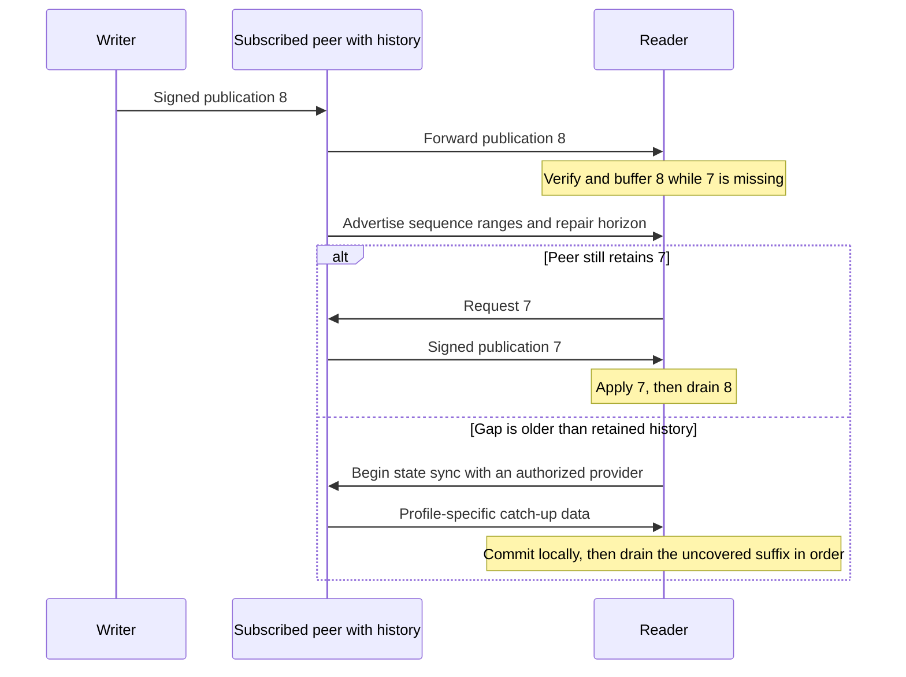

# Netz

Netz is an authenticated peer-to-peer networking layer for
[Kabel](https://github.com/replikativ/kabel). It provides peer identity,
membership, topic dissemination, recent-message repair, content exchange, and
an application-defined state-synchronization boundary.

The reference implementation runs on the JVM and in JavaScript through shared
Clojure/ClojureScript sources. A language-neutral protocol draft and a small
dependency-free Python CBOR/session core—including strict signed dissemination
and repair frames—plus a durable filesystem blob repository and transfer
machines define the path to implementations outside the Clojure ecosystem.

> **Alpha series: `0.1.<commit-count>` (Apache-2.0).** JVM, CLJS and Python
> share protocol fixtures and live interoperability tests. The experimental
> blob backend also has signed placement, repair and writer-process recovery
> tests; it is not yet a production distributed storage service. See
> [release readiness](RELEASE.md) and the [current storage verification](spec/stable-layout-draft.md)
> for evidence and remaining work.
>
> Public dialing is limited to explicitly configured `wss` gateways. Arbitrary
> public discovery still needs socket-level resolved-IP pinning. Identity-key
> rotation remains reserved.

## Use it from an application

Suppose a writer commits a new database snapshot while a reader is subscribed to
its branch. The writer announces a small signed reference on a topic. The reader
verifies the publisher, fetches the catalogue and any missing blocks by content
ID, and opens that exact commit. Later readers can catch up from the writer's
stored references, even if they missed the live announcement.

Here is the application-facing part of the JVM example. It assumes two connected
Kabel peers with Netz pub/sub installed. Each peer has its own snapshot-reference
strategy for the same stream, pinned to the writer's Authority ID.

```clojure
(require '[kabel.pubsub :as kabel]
         '[netz.core :as netz]
         '[netz.snapshot-ref :as ref]
         '[superv.async :refer [<?? S]])

(def topic "netz/demo/datahike-roots")

;; Both peers use the same profile name, system and branch bytes, and pinned
;; writer Authority. Each owns a separate (atom (ref/make-state)).
(defn strategy [state]
  (netz/snapshot-ref-strategy {:state state :profile profile-name :system system-id
                               :ref branch-name :publisher writer-authority}))

;; At the writer, serve catch-up requests from the local reference history.
(kabel/register-topic! writer topic {:strategy (strategy writer-state)})

;; At the reader, apply catch-up items and subsequent live values locally.
(<?? S (netz/subscribe! reader #{topic}
                        {:strategies {topic (strategy reader-state)}}))

;; At the writer, after storing the blocks and accepting the signed reference
;; into writer-state, announce its encoded bytes.
(<?? S (netz/publish! writer topic (ref/encode signed-reference)))
```

Run `clojure -M:replica-demo` for the complete example, including identities,
strategy construction and block verification. The reader starts with 1,200
notes, sees one live addition, catches up two missed additions, and queries all
1,203 from disk after the writer goes away. [Runnable source](examples/netz/examples/datahike_replica.clj)
· [Walkthrough](docs/datahike-replica-demo.md)

## How state reaches another peer

A publication has an origin, epoch, topic and sequence number. Consider a reader
that has applied through sequence 6 in one stream and receives 8 before 7.



The diagram uses one neighbor that can both relay and serve state. A deployment
can assign those roles to different peers. Successful `publish!` means local
acceptance. The reader advances its application frontier only after its own
apply succeeds. Ordering is per origin, epoch and topic; an application with
multiple writers defines how their updates combine.

For example, the reference grow-only set profile makes that last choice explicit.
If the writer holds `{a, b, c}` and the reader holds `{b, d}`, the reader can
catch up while preserving its own addition `d`:

```text
reader summary   = {b, d}
writer delta     = writer state ∖ reader summary = {a, c}
staged state     = reader state ∪ received chunks
committed state  = current reader state ∪ staged state ∪ writer checkpoint
                 = {a, b, c, d}
```

Set union makes repeated chunks harmless and independent additions commute.
Other profiles use different rules. The database example verifies a signed
snapshot reference and its blocks. Netz supplies peer authentication, bounded
repair and the sync session; the profile decides which state to accept.
[Set profile](src/netz/sync/join_semilattice.cljc) · [Synchronization model](docs/synchronization.md)

## What Netz owns

| Layer | Responsibility |
|---|---|
| Identity | Self-certifying peers and connection proof |
| Membership | Bounded peer exchange, dialing, backoff, and topology diversity |
| Dissemination | Signed topic messages, deduplication, and bounded repair |
| Content | Content-addressed block discovery and subtree transfer |
| Durable blobs | Experimental Konserve/file placement, receipts, lifecycle, and repair |
| Synchronization | Pure acknowledged sessions with application-defined profiles |
| Runtime | Kabel/WebSocket integration, limits, lifecycle, and persistence hooks |

Discovery is not authority. Netz may find a peer or content provider, but
application policy decides who may publish, write, decrypt, or vote. Raft
membership, CRDT semantics, access control, and storage encryption remain
above the network layer.

## Start here

Build and test the current checkout:

```sh
clojure -X:test :dirs '["test"]'
npm ci
clojure -M:test:secure-test:konserve:cljs -m shadow.cljs.devtools.cli compile node-test
node target/node-tests.js
python3 -m unittest discover -s interop/python -v
python3 -m pip wheel . --no-deps --wheel-dir /tmp/netz-python-dist
clojure -T:build jar
```

The complete Python suite needs the optional secure client dependencies first:

```sh
python3 -m pip install '.[secure-client]'
```

Compile the three Node peers before running the mixed JVM, Node, and Python tests:

```sh
clojure -M:test:secure-test:konserve:mixed-test:cljs -m shadow.cljs.devtools.cli compile mixed-content mixed-sync mixed-dissemination
NETZ_PYTHON=python3 clojure -X:secure-test:mixed-test :dirs '["test-mixed"]'
```

Maintainers with sibling checkouts can also run the real stack seams without
adding them to the published artifact:

```sh
clojure -X:stack :dirs '["test-stack"]'
```

The curated application API is `netz.core`. Constructing the underlying Kabel
peer is transport-specific, so the complete lifecycle is documented in
[Getting started](docs/getting-started.md).

## Design

A Kademlia DHT is deliberately not required. Bounded peer exchange and
two-hop provider discovery cover the current deployments; a DHT can later be
added as another routing provider without changing application sync.

The experimental durable-blob profile uses signed, hash-chained replica layouts
and treats owner and physical site as explicit failure domains. A detected
controller fork stops new retention admission. Its explicit controller runtime
restores durable intents and signed receipts before readiness, then persists
each begin, signed revision, or repair generation before handing offers to the
transfer runtime.
An optional portable scheduler now scans that durable evidence, waits an
initial grace period, and retries known-missing targets with bounded concurrency
and backoff. It does not treat a receipt as proof of future or Byzantine
retention.
The small executable walkthrough models encrypted data held by three private
home devices, quorum at two copies, and repair after one device is lost:

```sh
clojure -M:blob-demo
```

## Documentation

- [Getting started](docs/getting-started.md) — dependencies, lifecycle, and API
- [Architecture](docs/architecture.md) — boundaries and stack integration
- [Synchronization](docs/synchronization.md) — live, repair, and state-sync paths
- [Interoperability](docs/interoperability.md) — AT Protocol, libp2p, Willow, and DHT fit
- [Protocol draft](spec/netz-draft-00.md) — portable API and CBOR wire profile
- [Durable blob design](docs/resilient-blob-store.md) and
  [extension draft](spec/blob-replication-draft-00.md) — optional private replicas
- [Blob backend roadmap](docs/blob-backend-roadmap.md) — storage guarantees,
  stable-placement prototype, migration safety, and remaining release gates
- [Replica connectivity](docs/replica-connectivity.md) — bounded placement-target
  dial priority, lifecycle, diagnostics, and guarantee boundaries
- [Datahike locality experiment](docs/datahike-locality.md) — producer-planned
  durable replicas versus consumer-populated read caches
- [Multi-process Datahike experiment](docs/datahike-process-experiment.md) —
  static EDN bootstrap, cross-process `N/W` durability, replacement repair and
  an offline query after writer loss
- [Storage GC](docs/storage-gc.md) — Datahike/Yggdrasil reachability versus
  pool retention and surplus-replica retirement
- [Storage consolidation](docs/storage-consolidation.md) — Konserve checkpoint
  integration, shared validation and remaining backend qualification
- [Konserve-backed object exchange](docs/konserve-object-exchange.md) — stack
  integration, object/ref publication boundary, and Git-like materialization
- [Python interoperability core](interop/python/README.md) — CBOR, sync,
  reconnecting dissemination, and durable-blob APIs
- [Release readiness](RELEASE.md), [security policy](SECURITY.md), and
  [changelog](CHANGELOG.md)
- [Maintainer release procedure](docs/releasing.md) — synchronized JVM/Python
  commit-count versions and automatic publication from green `main`

## License

Copyright © 2026 Christian Weilbach. Licensed under the
[Apache License 2.0](LICENSE).
